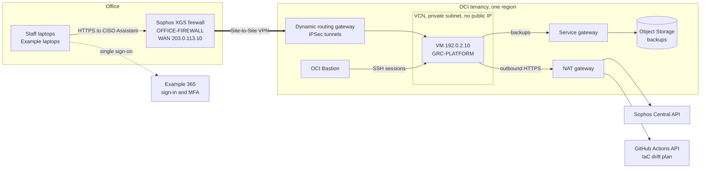

# Onboarding tutorial: a privately hosted GRC platform on Oracle Cloud

This tutorial onboards one realistic stack end to end for the fictional Example Pty Ltd. Its CISO Assistant and Evidence Hound run on
one private virtual machine in Oracle Cloud Infrastructure (OCI), and the office reaches them over a site-to-site VPN through its Sophos
XGS firewall. You onboard two systems with `hound onboard`: the GRC platform itself, because the compliance platform is in scope too,
and the office firewall. Then you review, validate, plan and apply.

Everything here is made up apart from the public product names. Addresses come from the documentation ranges (192.0.2.0/24,
198.51.100.0/24 and 203.0.113.0/24) and stand in for your own; use private ranges that do not overlap between the office and the cloud.
You start from a copy of the template compliance repo, `examples/compliance-repo`. Every file the tutorial writes is in
[`examples/onboarding-tutorial`](../../examples/onboarding-tutorial/README.md), at the same paths, so you can compare your result with it.
The template itself stays without them, so a new repo still starts empty.

It assumes you have read [Onboarding](../onboarding.md) and, for installing the stack, the
[first deployment tutorial](../tutorials/first-deployment.md). To try the whole deployment on your machine first, with fictional tenants
for Sophos Central, Microsoft 365 and the IaC pipeline and no account or key, run [`make trial`](../tutorials/local-trial.md): it walks
the same third parties, systems, audits, controls and collectors.

## The deployment



Inside the VM, the reference Compose stack runs Caddy, CISO Assistant's frontend, backend and worker, PostgreSQL and the `hound` runner
(see the [stack's guide](../../deploy/compose/README.md)).

**Which traffic goes where**

| From | To | How |
| --- | --- | --- |
| Staff in the office (198.51.100.0/24) | CISO Assistant | HTTPS to Caddy on the VM, port 443, through the XGS and the Site-to-Site VPN. Nothing else reaches the VM. |
| Staff | Example 365 | Single sign-on into CISO Assistant, with MFA enforced by the identity provider. |
| Administrators | The VM's shell | SSH only through OCI Bastion sessions (time-limited, signed in to OCI), or over the VPN from the office. |
| The `hound` runner | CISO Assistant | Inside the Compose network, to the backend; it never leaves the VM. |
| The `hound` runner | Sophos Central and GitHub's API | Outbound HTTPS through the NAT gateway. No inbound port is opened for it. |
| The VM | Object Storage | Nightly database dumps through the service gateway, never over the internet. |

**Each part, and what covers it**

| Part | How it is protected | Covered by |
| --- | --- | --- |
| The VM and its operating system | Private subnet, no public IP, Ubuntu LTS with unattended security updates | GRC-PLATFORM's audit: patching (ISM-1695, ISM-1501) as manual evidence |
| CISO Assistant sign-in | Single sign-on with Example 365 | GRC-PLATFORM's audit: MFA rows provided by Example 365 |
| TLS | Caddy terminates HTTPS with its own certificate authority, or yours | The first deployment tutorial |
| PostgreSQL and its backups | On the VM's encrypted boot volume; nightly dumps to an Object Storage bucket with a retention rule, weekly volume backups | GRC-PLATFORM's audit: the bucket's rows (ISM-1811, ISM-1705, ISM-1812, ISM-1707, ISM-1814) from the control tests `backups_private_and_in_another_region`, `backups_retention_locked`, `storage_encrypted` and `only_backup_admins_reach_backups` with the drift check (step 6); taking backups and restore tests (ISM-1511, ISM-1810, ISM-1515) as manual evidence |
| Secrets | Files in `/etc/evidence-hound/secrets` on the VM, given to containers as Docker secrets under `/run/secrets`; never in the repo | The first deployment tutorial |
| The runner's schedule | `hound serve` runs each collector in `hound.yaml` on its cron schedule, in `scheduler.time_zone` | The collector health control `AC-AUTO-EVIDENCE` |
| The network path | Private subnet with no public IP, HTTPS only from the office, SSH only from the Bastion, the VPN carrying the office network only | The control tests `vm_has_no_public_ip`, `https_only_from_the_office`, `office_range_is_not_the_internet`, `no_ssh_from_the_internet`, `vpn_routes_only_the_office` and `vm_metadata_v2_only` (step 6): evidence kept with each run; the Essential Eight has no row for them |
| The cloud configuration | Terraform in its own repository, with control tests on every change and a nightly refresh-only plan | The `grc-infra-controls` and `terraform-drift` profiles (steps 5 and 6) |
| The office firewall | Firmware in support and upgraded within two weeks, few Super Admins in Sophos Central | OFFICE-FIREWALL's audit: ISM-1501, ISM-1694 and ISM-1883 from the `sophos-central` profile |

## 1. Build the platform on OCI

1. **The shape.** An x86 (AMD) VM, `VM.Standard.E5.Flex`, with 2 OCPUs (4 vCPUs), 16 GB of memory and a 100 GB balanced boot volume,
   runs CISO Assistant's Compose stack and the runner with room to spare. Oracle's price list, checked on 23 November 2026, gives USD 0.03
   per OCPU per hour, USD 0.002 per GB of memory per hour, and USD 0.0255 per GB per month for block volume storage plus USD 0.0017 per
   performance unit per GB per month (10 units for balanced). That is about USD 44 for the OCPUs, USD 23 for the memory and USD 4 for the
   boot volume: **about USD 71 per month**, before backups in Object Storage and outbound data. Site-to-Site VPN and Bastion are free.
   Check the price list again before you commit to it.
2. **The network.** Create a VCN with one private subnet. Turn off "Assign a public IPv4 address" for the VM, so it has no public IP. Its
   security list allows HTTPS (443) only from the office network, through the VPN, and SSH only from the Bastion. Add a NAT gateway for
   outbound HTTPS and a service gateway for Object Storage.
3. **The Site-to-Site VPN.** Create a dynamic routing gateway (DRG) attached to the VCN, a customer-premises equipment object for the
   XGS's public address (203.0.113.10 here), and an IPSec connection with a static route to the office network. OCI gives two tunnel
   endpoints (203.0.113.101 and 203.0.113.102 here). On the XGS, add an IPsec site-to-site connection to each, with the shared secrets OCI
   shows, and a firewall rule that lets the office reach the VM on 443 only.
4. **The Bastion.** Create an OCI Bastion for the private subnet. Administrators open a time-limited managed SSH session to the VM; no SSH
   port faces the internet.
5. **The stack.** Install it as in the [first deployment tutorial](../tutorials/first-deployment.md), from step 3, with
   `CA_HOSTNAME=ciso.example.com` resolved by the office's DNS to the VM's private address (192.0.2.10). The secrets folder stays on the
   VM; Docker gives each container only the secrets it needs.
6. **Backups.** Schedule a nightly database dump to an Object Storage bucket in another region with a retention rule, and a weekly backup
   policy on the boot volume. Test a restore to a scratch VM each quarter; that test is the evidence for ISM-1515.
7. **The infrastructure code.** Keep the VCN, VM, VPN and bucket as Terraform in a repository of its own, with a nightly plan workflow
   (see [Infrastructure drift from your IaC pipeline](../collectors/terraform-drift.md)) and control tests on every change (step 6). The
   cloud credentials stay in that pipeline. The tutorial's Terraform is in
   [`examples/onboarding-tutorial/infra/oci`](../../examples/onboarding-tutorial/infra/oci/main.tf): steps 2 to 6 above as code, with
   fictional values.

**On another cloud.** Only the names change: a VM in a private subnet with no public address, the provider's site-to-site IPsec VPN, its
bastion or session manager, a NAT gateway for outbound HTTPS and object storage for backups. The supplier is your provider instead of
`SUP-ORACLE`, and the Essential Eight decisions below hold as they are.

## 2. Suppliers first

A system is registered in CISO Assistant only once its supplier is approved, so the supplier register comes first. The platform has four:

| Supplier | What it provides | How it gets into the register |
| --- | --- | --- |
| `SUP-ORACLE` | The VM, network, VPN, Bastion and storage that host the GRC platform | Drafted by `hound onboard GRC-PLATFORM` (step 3), then reviewed |
| `SUP-SOPHOS` | The office firewall and Sophos Central, which manages it | Drafted by `hound onboard OFFICE-FIREWALL` (step 4), then reviewed |
| `SUP-CISO-ASSISTANT` | The CISO Assistant community edition, run from its published images | Written by hand: [`scope/third-parties/sup-ciso-assistant.yaml`](../../examples/onboarding-tutorial/scope/third-parties/sup-ciso-assistant.yaml) |
| `SUP-EVIDENCE-HOUND` | The `hound` runner and its profile library | Written by hand: [`scope/third-parties/sup-evidence-hound.yaml`](../../examples/onboarding-tutorial/scope/third-parties/sup-evidence-hound.yaml) |

The open-source projects have no system of their own, since GRC-PLATFORM is registered under its host, so write their files by hand. Their
contract is the licence, with no contract value, and each has a yearly review, like any supplier the platform depends on.

The commands below run from the root of this repository. Copy the template, and add the two open-source supplier files (write your own
the same way):

```sh
cp -R examples/compliance-repo /tmp/grc-repo
mkdir -p /tmp/grc-repo/scope/third-parties
cp examples/onboarding-tutorial/scope/third-parties/sup-ciso-assistant.yaml examples/onboarding-tutorial/scope/third-parties/sup-evidence-hound.yaml /tmp/grc-repo/scope/third-parties/
```

## 3. Onboard the GRC platform

1. **Start.** You decide each level and decision yourself here. With a coding assistant set up by `hound agent setup`, it drafts
   them through `hound` and you approve with `hound approve`.

   ```sh
   hound onboard GRC-PLATFORM --repo /tmp/grc-repo --group 1 --group 2
   ```

   Groups 1 and 2 are Essential Eight maturity levels one and two: 107 requirements. Answer the first questions:

   | Question | Answer |
   | --- | --- |
   | Your name | Sam Example |
   | System owner's email | <it@example.com> |
   | Product | CISO Assistant and Evidence Hound on an OCI Compute VM |
   | Supplier ref_id and name | `ORACLE` after the `SUP-` the prompt shows, Oracle Cloud Infrastructure |
   | Solution ref_id and name | `OCI-HOSTING` after `SOL-`, OCI compute, networking and storage |
   | Contract ref_id and name | `OCI-2026` after `CTR-`, OCI pay-as-you-go 2026 |
   | What it provides | The private VM, network, site-to-site VPN, bastion, block volumes, object storage, logging and vault that host the GRC platform |
   | A vendor document | Enter, for none |
   | Each of the five levels | Enter, to decide it in the file in the next step, or a number from the scale printed above it and a reason |

   Each question comes with a line saying what it is for and an example.

   Oracle is a new supplier, so `hound` drafts `scope/third-parties/sup-oracle.yaml` with a draft contract and a review, `EA-SUP-ORACLE`,
   and stops.

2. **Review the supplier.** Decide its four levels and the solution's criticality in the file, each with its reason. Compare yours with
   [`scope/third-parties/sup-oracle.yaml`](../../examples/onboarding-tutorial/scope/third-parties/sup-oracle.yaml). Then approve it
   yourself, in a terminal:

   ```sh
   hound approve --repo /tmp/grc-repo
   ```

   It shows the supplier and makes the contract `active` when you approve it, then concludes the review `EA-SUP-ORACLE` (`ok`,
   `warning` or `blocker`), recorded under `conclusions:` in the file. It refuses to run without a person at a terminal, so an agent
   cannot approve for you.

3. **Decide applicability.** Run the same command again, with the same groups. For each requirement type `m` (manual evidence), `n` (not
   applicable, with a justification and who approved it), `o` (another system meets it, naming that system) or `c` (an API check), each
   with your reasoning. Type `s` to stop; the next run carries on. The decisions for this VM:

   - **Not applicable (61):** the platform has no public address and is not an online service, so the online-service patching and MFA
     rows do not apply. Application control, Microsoft Office macros and user application hardening at maturity level two cover
     workstations and internet-facing servers, and this is a private Linux container host with no office suite, browser or PDF software.
     Each has its justification and "Approved by Alex Example".
   - **Manual evidence (32):** patching (OCI Vulnerability Scanning, unattended upgrades, pinned images updated through a pull request),
     taking backups and restore tests, privileged access reviews, logging to OCI Logging, and incident response.
   - **API check (5):** the backup bucket's rows (ISM-1811, ISM-1705, ISM-1812, ISM-1707 and ISM-1814), from the control tests and the
     drift check (steps 5 and 6).
   - **Another system (9):** MFA for the platform's users and administrators is provided by Example 365, through single sign-on; the
     privileged operating environment rows by the administrators' Example laptops.

   To replay these decisions instead of typing them, give the tutorial's answers as input:

   ```sh
   hound onboard GRC-PLATFORM --repo /tmp/grc-repo --group 1 --group 2 < examples/onboarding-tutorial/answers/grc-platform.decisions.txt
   ```

   At the end, accept the default domain and perimeter. It writes the audit
   `scope/audits/grc-platform-essential-eight-2023.yaml`, adds `GRC-PLATFORM` to `scope/setup.yaml` with its solution, and records every
   decision in `onboarding/grc-platform-essential-eight-2023-2026-11-23.md` (dated the day you run it). The answers to step 1 are in
   `examples/onboarding-tutorial/answers/grc-platform.supplier.txt`.

## 4. Onboard the office firewall

1. **Start and review the supplier** as in step 3, with `OFFICE-FIREWALL` and the answers in
   `examples/onboarding-tutorial/answers/office-firewall.supplier.txt`: supplier `SUP-SOPHOS`, solution `SOL-SOPHOS-FIREWALL`, contract
   `CTR-SOPHOS-2026`. Review the drafted `scope/third-parties/sup-sophos.yaml` as you did Oracle's.

   ```sh
   hound onboard OFFICE-FIREWALL --repo /tmp/grc-repo --group 1 --group 2
   ```

2. **Decide applicability.** Three requirements become API checks, which the `sophos-central` profile answers: ISM-1501 (the firmware is
   still supported), ISM-1694 (no firmware upgrade offered for more than two weeks) and ISM-1883 (few Sophos Central admins hold Super
   Admin). The firewall is an internet-facing network device, so the daily scan and the two-week firmware window apply, and ISM-1695
   (non-internet-facing devices) does not. Applications, application
   control, Office macros and user application hardening do not apply to an appliance.

   ```sh
   hound onboard OFFICE-FIREWALL --repo /tmp/grc-repo --group 1 --group 2 < examples/onboarding-tutorial/answers/office-firewall.decisions.txt
   ```

   The API check rows are left out of the audit file: the collector's results fill them.

3. **Collect them.** Copy the library's profile and its tests into the repo's profiles folder, which the runner mounts read-only, and test
   them offline:

   ```sh
   mkdir -p /tmp/grc-repo/profiles && cp -R profiles/sophos-central.yaml profiles/sophos-central.tests /tmp/grc-repo/profiles/
   hound profile test sophos-central --profiles /tmp/grc-repo/profiles
   ```

   Then take `hound.yaml`, `mappings/office-firewall-essential-eight-2023.yaml` and `deploy/compose.override.yml` from
   `examples/onboarding-tutorial` (compare them with the template's to see what changed):

   ```sh
   cp examples/onboarding-tutorial/hound.yaml /tmp/grc-repo/
   cp examples/onboarding-tutorial/mappings/office-firewall-essential-eight-2023.yaml /tmp/grc-repo/mappings/
   cp examples/onboarding-tutorial/deploy/compose.override.yml /tmp/grc-repo/deploy/
   ```

   The collector instance `example-sophos` in `hound.yaml` reads Sophos Central (see [Sophos Central](../collectors/sophos.md) for the
   API credential), and a second target sends its results to the firewall's audit through
   `mappings/office-firewall-essential-eight-2023.yaml`. Its client secret is the Docker secret `sophos_client_secret`, added to the runner
   in `deploy/compose.override.yml`.

## 5. Check the platform for drift

The `terraform-drift` profile reads the IaC pipeline's nightly plan through the GitHub Actions API, read only, and reports whether the
cloud still matches the reviewed code. `hound` never runs Terraform and never holds cloud credentials. Copy the profile and its tests as
in step 4, then see the instance `example-grc-infra-drift` in `hound.yaml`: it runs at 23:00, after the pipeline's 22:00 plan, with a
fine-grained token that reads only the IaC repository's Actions (the Docker secret `iac_actions_token`).

```sh
cp -R profiles/terraform-drift.yaml profiles/terraform-drift.tests /tmp/grc-repo/profiles/
hound profile test terraform-drift --profiles /tmp/grc-repo/profiles
```

Keep the Terraform in its own repository, as recommended in the [drift guide](../collectors/terraform-drift.md#where-the-terraform-lives):
each finding names that repository and the commit the plan was made from. A monorepo works too.

## 6. Prove the hosting controls

The hosting controls are written as Terraform tests in the IaC repository,
[`infra/oci/tests/controls.tftest.hcl`](../../examples/onboarding-tutorial/infra/oci/tests/controls.tftest.hcl): one `run` block per
control, such as `vm_has_no_public_ip` or `backups_retention_locked`. They use mock providers, so they need no Oracle account and create
nothing. Try them:

```sh
cd examples/onboarding-tutorial/infra/oci && terraform init -backend=false && terraform test
```

The IaC pipeline ([`controls.yml`](../../examples/onboarding-tutorial/infra/oci/.github/workflows/controls.yml)) runs them on every
change and weekly, and publishes the JUnit report as the `control-tests` artefact. The `grc-infra-controls` profile, the tutorial's copy
of `terraform-tests` with one check per control, reads it with the same Actions-read token (instance `example-grc-infra-controls` in
`hound.yaml`). Copy it and its tests into the repo:

```sh
cp -R examples/onboarding-tutorial/profiles/grc-infra-controls.yaml examples/onboarding-tutorial/profiles/grc-infra-controls.tests /tmp/grc-repo/profiles/
hound profile test grc-infra-controls --profiles /tmp/grc-repo/profiles
```

The GRC platform's mapping, [`grc-platform-essential-eight-2023.yaml`](../../examples/onboarding-tutorial/mappings/grc-platform-essential-eight-2023.yaml),
needs a control test **and** the drift check for each backup row: the test proves the code declares the setting, and the drift check
proves the live tenancy still matches the code. A mock alone proves only the code. See
[Hosting controls proven by your infrastructure tests](../collectors/terraform-tests.md).

## 7. Review, validate, plan and apply

1. **Review** the change as a pull request: the four supplier files, the two audits, the two systems in `scope/setup.yaml`, the onboarding
   records, `hound.yaml`, the two mappings and the `grc-infra-controls` profile. Each not applicable row carries its justification and approver, and each row met by
   another system names it.
2. **Validate** offline:

   ```sh
   cd /tmp/grc-repo && hound config validate hound.yaml && hound scope validate scope --config hound.yaml
   ```

3. **Suppliers, then systems.** A plan that registers a system whose supplier's review is not concluded ok is refused
   (`system.supplier_not_approved`) and nothing is applied. `hound approve` recorded `EA-SUP-ORACLE` and `EA-SUP-SOPHOS` as concluded
   in the supplier files (steps 3 and 4), and the plan counts those conclusions, so one plan applies the suppliers, their conclusions,
   the systems and their audits. The two open-source projects' reviews are concluded the same way: run `hound approve` once more if it
   still lists them. Then:

   ```sh
   cd /tmp/grc-repo && hound scope plan scope --config hound.yaml
   cd /tmp/grc-repo && hound scope apply scope --config hound.yaml
   ```

   The plan creates `GRC-PLATFORM`, `OFFICE-FIREWALL` and their audits, with every decided row.
4. **Run** the collectors once, then check their status:

   ```sh
   cd /tmp/grc-repo && hound run --config hound.yaml --only example-sophos
   cd /tmp/grc-repo && hound status --config hound.yaml
   ```

From then on, the runner's schedule keeps the firewall's two rows, the platform's five backup rows and the drift check current, and the
manual rows wait for their evidence.

## What your repo holds now

| File | Written by |
| --- | --- |
| [`scope/third-parties/`](../../examples/onboarding-tutorial/scope/third-parties/) | Oracle and Sophos drafted by onboarding and reviewed; the open-source projects by hand |
| [`scope/setup.yaml`](../../examples/onboarding-tutorial/scope/setup.yaml) | Onboarding: the two systems, each with its solution |
| [`scope/audits/grc-platform-essential-eight-2023.yaml`](../../examples/onboarding-tutorial/scope/audits/grc-platform-essential-eight-2023.yaml) | Onboarding |
| [`scope/audits/office-firewall-essential-eight-2023.yaml`](../../examples/onboarding-tutorial/scope/audits/office-firewall-essential-eight-2023.yaml) | Onboarding |
| [`onboarding/`](../../examples/onboarding-tutorial/onboarding/) | Onboarding: one record per system, every decision and who accepted it |
| [`hound.yaml`](../../examples/onboarding-tutorial/hound.yaml) | By hand: the three collector instances and the two systems' targets |
| [`mappings/office-firewall-essential-eight-2023.yaml`](../../examples/onboarding-tutorial/mappings/office-firewall-essential-eight-2023.yaml) | By hand: the firewall's three API checks |
| [`mappings/grc-platform-essential-eight-2023.yaml`](../../examples/onboarding-tutorial/mappings/grc-platform-essential-eight-2023.yaml) | By hand: the platform's five backup rows, each from its control tests and the drift check |
| [`profiles/grc-infra-controls.yaml`](../../examples/onboarding-tutorial/profiles/grc-infra-controls.yaml) | By hand: a copy of `terraform-tests` with one check per control |
| [`deploy/compose.override.yml`](../../examples/onboarding-tutorial/deploy/compose.override.yml) | By hand: the two collectors' secrets |

The audits in `examples/onboarding-tutorial` also start with a schema comment line, so editors check them; onboarding does not write it.
