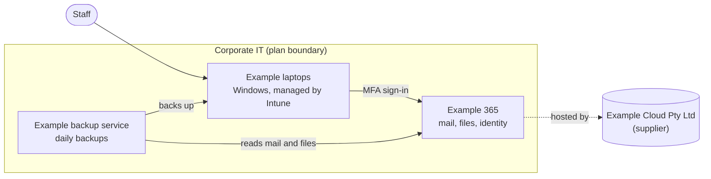

One office with a managed firewall, and cloud services. Staff work from the office and from home on company laptops only; there are no servers on site.

The boundary of the plan is the perimeter "Corporate IT". Everything inside the box below is in scope; the suppliers' platforms outside it are covered by their own assurance, recorded as third parties in CISO Assistant.

This diagram is fictional and drawn by hand: hound does not generate boundary or data flow diagrams.
